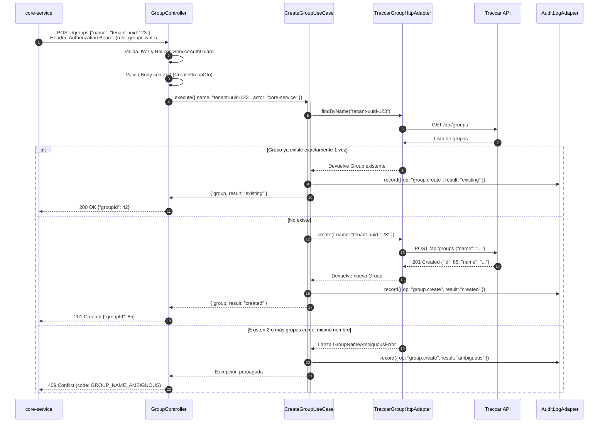
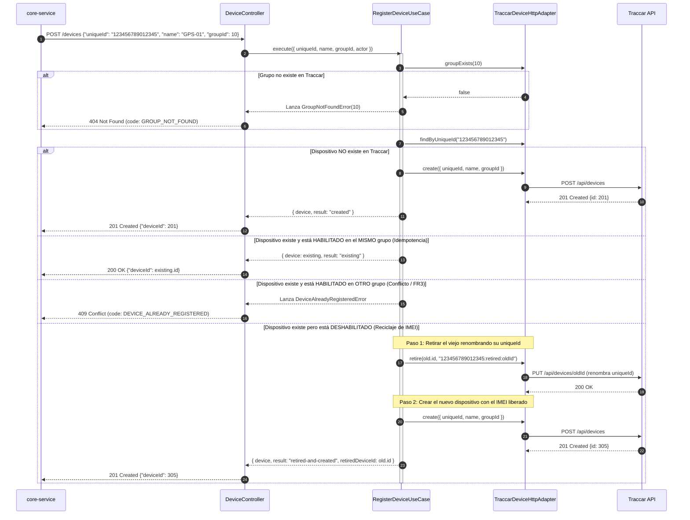
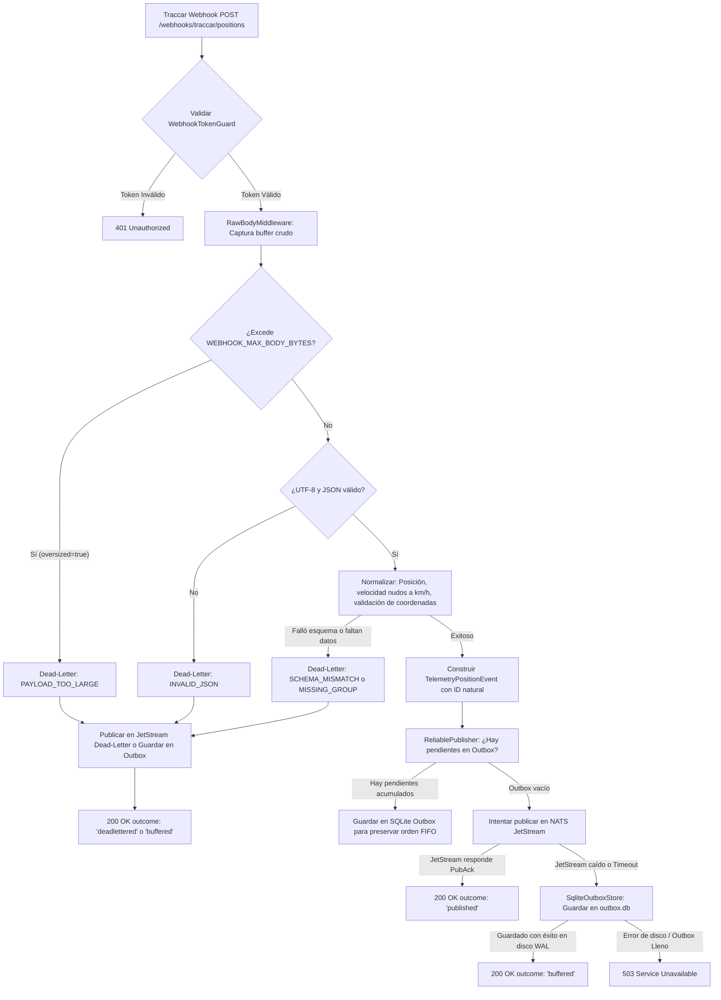
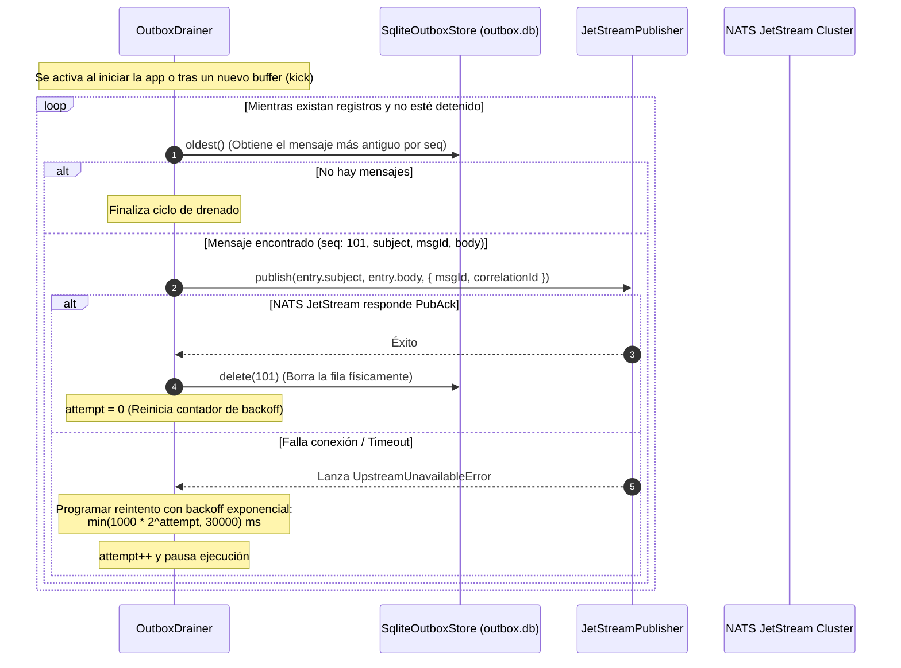

# Guía de Estudio y Análisis Técnico: traccar-adapter

> **Servicio:** `traccar-adapter`  
> **Ecosistema:** Plataforma de Telemetría Vehicular Multi-tenant  
> **Stack:** NestJS 12, Node.js 24 LTS (ESM), TypeScript Strict, NATS JetStream, SQLite Embebido (`node:sqlite`), Keycloak, Pino, Zod, Vitest, Oxlint, Docker  
> **Documento de Referencia:** Arquitectura, Tecnologías, Decisiones de Diseño y Guía de Aprendizaje  

---

## Tabla de Contenidos

1. [Visión General y Propósito del Sistema](#1-visión-general-y-propósito-del-sistema)
   - [El Ecosistema de Microservicios](#el-ecosistema-de-microservicios)
   - [La Misión de traccar-adapter: Anti-Corruption Layer (ACL)](#la-misión-de-traccar-adapter-anti-corruption-layer-acl)
   - [Ubicuidad de Vocabulario: Device y Group](#ubicuidad-de-vocabulario-device-y-group)
2. [Conceptos Arquitectónicos y Patrones de Diseño](#2-conceptos-arquitectónicos-y-patrones-de-diseño)
   - [Arquitectura Hexagonal (Ports & Adapters)](#arquitectura-hexagonal-ports--adapters)
   - [Estructura Feature-First vs. Layer-First (ADR-0001)](#estructura-feature-first-vs-layer-first-adr-0001)
   - [Diseño Stateless con Outbox Local de Entrega (ADR-0007)](#diseño-stateless-con-outbox-local-de-entrega-adr-0007)
   - [Autenticación Servicio a Servicio (S2S) y Modelo Zero-Trust (ADR-0003)](#autenticación-servicio-a-servicio-s2s-y-modelo-zero-trust-adr-0003)
   - [Trazabilidad Distribuida y Observabilidad (ADR-0002)](#trazabilidad-distribuida-y-observabilidad-adr-0002)
   - [Auditoría Desacoplada en Capa de Aplicación (ADR-0006)](#auditoría-desacoplada-en-capa-de-aplicación-adr-0006)
   - [Deduplicación de Eventos y Manejo de Dead-Letter (ADR-0004 & FR10)](#deduplicación-de-eventos-y-manejo-de-dead-letter-adr-0004--fr10)
   - [Invariantes Duras de Dominio](#invariantes-duras-de-dominio)
3. [Stack Tecnológico y Justificación de Herramientas](#3-stack-tecnológico-y-justificación-de-herramientas)
   - [Runtime, Lenguaje y Empaquetado](#runtime-lenguaje-y-empaquetado)
   - [Framework y Servidor HTTP](#framework-y-servidor-http)
   - [Mensajería Asíncrona (Message Broker)](#mensajería-asíncrona-message-broker)
   - [Persistencia Efímera y Concurrencia](#persistencia-efímera-y-concurrencia)
   - [Seguridad, Criptografía y Validación](#seguridad-criptografía-y-validación)
   - [Logging y Rendimiento](#logging-y-rendimiento)
   - [Calidad de Código y Testing](#calidad-de-código-y-testing)
   - [Infraestructura y Contenedores](#infraestructura-y-contenedores)
   - [Metodología SDD (Spec-Driven Development)](#metodología-sdd-spec-driven-development)
4. [Registro de Decisiones Arquitectónicas (ADRs Deep-Dive)](#4-registro-de-decisiones-arquitectónicas-adrs-deep-dive)
   - [ADR-0001: Hexagonal Feature-First con Capas Puras](#adr-0001-hexagonal-feature-first-con-capas-puras)
   - [ADR-0002: Convenciones de Plataforma (Correlation ID, Health, Errores y Logs)](#adr-0002-convenciones-de-plataforma)
   - [ADR-0003: Autenticación S2S con Keycloak (Client Credentials + JWKS)](#adr-0003-autenticación-s2s-con-keycloak)
   - [ADR-0004: Contrato de Eventos en JetStream y Estrategia de IDs](#adr-0004-contrato-de-eventos-en-jetstream)
   - [ADR-0005: Integración con Traccar e Idempotencia](#adr-0005-integración-con-traccar-e-idempotencia)
   - [ADR-0006: Auditoría de Operaciones en Capa de Aplicación](#adr-0006-auditoría-de-operaciones-en-capa-de-aplicación)
   - [ADR-0007: Outbox Local de Entrega con SQLite Embebido](#adr-0007-outbox-local-de-entrega)
5. [Flujos del Sistema Paso a Paso](#5-flujos-del-sistema-paso-a-paso)
   - [Flujo 1: Creación Idempotente de Grupo](#flujo-1-creación-idempotente-de-grupo)
   - [Flujo 2: Registro de Dispositivo y Reciclaje de IMEI](#flujo-2-registro-de-dispositivo-y-reciclaje-de-imei)
   - [Flujo 3: Ingesta Webhook, Contingencia Outbox y Dead-Letter](#flujo-3-ingesta-webhook-contingencia-outbox-y-dead-letter)
   - [Flujo 4: Drenado del Outbox en Segundo Plano](#flujo-4-drenado-del-outbox-en-segundo-plano)
6. [Resiliencia, Salud y Ciclo de Vida](#6-resiliencia-salud-y-ciclo-de-vida)
   - [Liveness vs. Readiness con Dependencias Críticas y No Críticas](#liveness-vs-readiness)
   - [Apagado Elegante (Graceful Shutdown)](#apagado-elegante-graceful-shutdown)
7. [Cuestionario de Estudio y Autoevaluación](#7-cuestionario-de-estudio-y-autoevaluación)

---

## 1. Visión General y Propósito del Sistema

### El Ecosistema de Microservicios

La plataforma de telemetría vehicular está diseñada bajo una arquitectura distribuida orientada a eventos (*event-driven*) y servicios REST sincrónicos para comandos. Se compone de 5 microservicios coordinados:

```
                                  ┌────────────────────────┐
                                  │      api-gateway       │ (Borde exterior, enrutamiento,
                                  └───────────┬────────────┘  autenticación de usuarios)
                                              │ REST (S2S + Bearer)
                                              ▼
┌─────────────────┐             ┌────────────────────────┐
│  telemetry-db   │             │      core-service      │ (Entidades de negocio:
│ (Histórico GPS) │             └───────────┬────────────┘  Vehículos, Tenants, Flotas)
└────────┬────────┘                         │ REST (S2S: groups, devices)
         ▲                                  ▼
         │ NATS Push             ┌────────────────────────┐             ┌─────────────────────┐
┌────────┴────────┐  JetStream   │    traccar-adapter     │  HTTP REST  │    Traccar Server   │
│telemetry-service│◄─────────────┤ (Anti-Corruption Layer)├────────────►│(Multi-protocol GPS) │
└─────────────────┘              └───────────▲────────────┘◄────────────┴─────────────────────┘
                                             │               Webhooks (posiciones y eventos)
┌─────────────────┐  JetStream               │
│realtime-gateway ├◄─────────────────────────┘
│  (WebSockets)   │
└─────────────────┘
```

1. **`api-gateway`**: Punto de entrada perimetral. Enruta peticiones externas, valida usuarios finales y propaga la cabecera `x-correlation-id`.
2. **`core-service`**: Corazón del dominio del negocio. Gestiona Tenants (inquilinos), Vehículos, Usuarios y Asociaciones. Es el dueño de la relación `tenant_id ↔ traccar_group_id` y `vehicle_id ↔ traccar_device_id`.
3. **`traccar-adapter`** *(este servicio)*: Capa de adaptación anti-corrupción. Es el **único** servicio que conoce y habla con el servidor Traccar.
4. **`telemetry-service`**: Consume eventos normalizados desde NATS JetStream, resuelve el Tenant consultando al `core-service`, filtra ruido (ej. vehículos detenidos) y almacena el historial cronológico de posiciones.
5. **`realtime-gateway`**: Provee canales WebSocket bidireccionales hacia el frontend web/móvil para visualizar vehículos en vivo sobre el mapa.

---

### La Misión de traccar-adapter: Anti-Corruption Layer (ACL)

En Domain-Driven Design (DDD), un **Anti-Corruption Layer (Capa Anti-Corrupción)** es un patrón arquitectónico que traduce la semántica, protocolos y modelos de datos entre dos subsistemas distintos, evitando que el modelo de un sistema externo "contamine" el modelo de dominio interno.

Traccar es un servidor open-source maduro capaz de comunicarse con cientos de protocolos binarios propietarios de dispositivos GPS físicos (Teltonika, Coban, Concox, Queclink, etc.). Sin embargo:
- Su API REST y su base de datos tienen su propio modelo conceptual (`tc_devices`, `tc_groups`, `tc_positions`).
- Traccar reporta la velocidad en **nudos** (*knots*).
- Traccar reenvía posiciones por webhook HTTP antes de guardarlas en su base de datos.
- Traccar no tiene concepto de "Vehículo de flota", "Tenant SaaS" ni "Auditoría empresarial".

Si `core-service` o `telemetry-service` se comunicaran directamente con Traccar:
1. El código de negocio quedaría acoplado a las particularidades y cambios de versión de Traccar.
2. Si el día de mañana se reemplaza Traccar por otro motor de ingestión (o un servicio IoT en AWS/GCP), habría que reescribir toda la plataforma.

**Con `traccar-adapter` como ACL:**
- El resto del sistema interactúa con una API limpia y uniforme.
- Si Traccar cambia o se reemplaza, **únicamente** se modifica `traccar-adapter`.

---

### Ubicuidad de Vocabulario: Device y Group

Una de las reglas no negociables de diseño en este servicio es el **Lenguaje Ubicuo Estricto**:
- En `traccar-adapter` **solo existen `Device` y `Group`**.
- Está terminantemente prohibido utilizar conceptos como `Vehicle`, `Tenant`, `Driver` o `Fleet`.
- **Razón técnica:** Mantener la frontera de responsabilidades. `traccar-adapter` no sabe qué vehículo corresponde a qué dispositivo GPS, ni qué empresa es dueña de qué grupo. Esa correlación vive exclusivamente en `core-service`.

---

## 2. Conceptos Arquitectónicos y Patrones de Diseño

### Arquitectura Hexagonal (Ports & Adapters)

La Arquitectura Hexagonal, formulada por Alistair Cockburn, busca aislar el núcleo de lógica de la aplicación de las tecnologías de entrada/salida (I/O), frameworks y protocolos externos.

```
┌────────────────────────────────────────────────────────────────────────┐
│                        INFRASTRUCTURE LAYER                            │
│  ┌─────────────────────────┐            ┌───────────────────────────┐  │
│  │     Inbound Adapters    │            │     Outbound Adapters     │  │
│  │  - Express Controllers  │            │  - Traccar HTTP Client    │  │
│  │  - Zod Validation Pipes │            │  - JetStream Publisher    │  │
│  │  - Keycloak JWT Guards  │            │  - SQLite Outbox Store    │  │
│  │  - Raw Body Middleware  │            │  - Pino Audit Adapter     │  │
│  └────────────┬────────────┘            └─────────────▲─────────────┘  │
│               │ Invocación                            │ Implementa     │
│               ▼                                       │ interfaz       │
│  ┌────────────────────────────────────────────────────┴─────────────┐  │
│  │                      APPLICATION LAYER                           │  │
│  │  ┌────────────────────────────────────────────────────────────┐  │  │
│  │  │ Use Cases (Clases TypeScript puras sin decoradores)         │  │  │
│  │  │ - CreateGroupUseCase        - SetDeviceStatusUseCase       │  │  │
│  │  │ - RegisterDeviceUseCase     - IngestTraccarPayloadUseCase  │  │  │
│  │  └─────────────────────────┬──────────────────────────────────┘  │  │
│  │                            │ Orquesta                            │  │
│  │  ┌─────────────────────────▼──────────────────────────────────┐  │  │
│  │  │ Ports (Interfaces TypeScript + Injection Symbols)          │  │  │
│  │  │ - TraccarGroupPort          - EventPublisherPort           │  │  │
│  │  │ - TraccarDevicePort         - DeadLetterPublisherPort      │  │  │
│  │  │ - AuditLogPort              - ClockPort                    │  │  │
│  │  └────────────────────────────────────────────────────────────┘  │  │
│  │                            │ Depende                             │  │
│  │                            ▼                                     │  │
│  │  ┌────────────────────────────────────────────────────────────┐  │  │
│  │  │                      DOMAIN LAYER                          │  │  │
│  │  │  - Entidades puras (Device, Group)                         │  │  │
│  │  │  - Value Objects (Imei, retiredUniqueId)                   │  │  │
│  │  │  - Errores de Dominio (DomainError, GroupNotFoundError)   │  │  │
│  │  │  - Reglas de normalización de telemetría                   │  │  │
│  │  └────────────────────────────────────────────────────────────┘  │  │
│  └──────────────────────────────────────────────────────────────────┘  │
└────────────────────────────────────────────────────────────────────────┘
```

#### Regla de Dependencia Estricta
Las capas interiores **desconocen** a las capas exteriores:
$$\text{Domain} \longleftarrow \text{Application} \longleftarrow \text{Infrastructure}$$

- **`domain`**: No importa `@nestjs/*`, ni Express, ni librerías de I/O.
- **`application`**: Solo conoce `domain` y sus propios puertos. No contiene decoradores `@Injectable()` ni referencias a transportes HTTP o colas.
- **`infrastructure`**: Implementa los puertos y configura los controladores, módulos y dependencias de NestJS.

---

### Estructura Feature-First vs. Layer-First (ADR-0001)

El proyecto organiza su código agrupando por **funcionalidad primero y capa después**, en lugar de crear carpetas monolíticas globales (`controllers/`, `services/`, `models/`):

```
src/
├── app.module.ts
├── main.ts
├── modules/
│   ├── device/              # Feature: Dispositivos GPS
│   │   ├── domain/
│   │   ├── application/
│   │   │   ├── ports/
│   │   │   └── use-cases/
│   │   ├── infrastructure/
│   │   │   ├── inbound/     # Controllers, DTOs
│   │   └── outbound/    # HTTP Adapters hacia Traccar
│   │   └── device.module.ts
│   ├── group/               # Feature: Grupos de Traccar
│   └── ingestion/           # Feature: Webhooks y Normalización
└── shared/                  # Componentes transversales
    ├── domain/              # Errores base (DomainError)
    ├── application/         # Ports transversales (AuditLogPort, ClockPort)
    └── infrastructure/      # Auth JWT, Logging, NATS, Outbox
```

#### ¿Por qué Feature-First?
1. **Alta Cohesión y Bajo Acoplamiento:** Todo lo que cambia junto para una funcionalidad (`Device`) vive en el mismo directorio.
2. **Carga Cognitiva Reducida:** Tanto para desarrolladores humanos como para agentes de IA (Claude Code / Antigravity), implementar un requerimiento solo requiere cargar en contexto los archivos de ese módulo específico.
3. **Control Automático con Linter:** En `.oxlintrc.json` se definen reglas `no-restricted-imports` para que el compilador y el linter prohíban que `modules/group` importe código privado de `modules/device`.

---

### Diseño Stateless con Outbox Local de Entrega (ADR-0007)

Originalmente, `traccar-adapter` fue concebido como un servicio **100% Stateless** (sin base de datos propia). Sin embargo, un análisis riguroso de Traccar 6.15.3 reveló un riesgo crítico de pérdida de datos:
- **Eventos de Traccar:** Cuando ocurre una alarma o un evento crítico (ej. botón de pánico, exceso de velocidad), Traccar envía un webhook HTTP POST a `traccar-adapter`. Si este endpoint responde `503 Service Unavailable` porque NATS está temporalmente caído, **Traccar nunca reintenta el evento**. Se pierde para siempre.
- **Posiciones GPS:** Aunque Traccar permite configurar reintentos en posiciones (`forward.retry.enable=true`), su cola interna es en memoria y finita (~17 minutos). Si el adapter o NATS están caídos más de ese lapso, Traccar lanza un `NullPointerException` interno y aborta el flujo.

#### La Solución: Local Delivery Outbox
Para garantizar que **ningún dato se pierda en silencio (FR10)** sin convertir al servicio en un almacén de datos de negocio:

```
[Traccar Webhook]
       │
       ▼
[WebhookController]
       │
       ▼
[IngestUseCase] ──(Normaliza / DLQ)──► [ReliablePublisher]
                                             │
                       ┌─────────────────────┴─────────────────────┐
                       │ ¿NATS JetStream disponible?               │
                      SÍ                                           NO
                       │                                           │
                       ▼                                           ▼
             [Publicar en JetStream]                     [SqliteOutboxStore]
                       │                                    (Buffer local en disco)
                       ▼                                           │
             [Responder 200 OK]                          [Responder 200 OK (buffered)]
                                                                   │
                                                                   ▼
                                                         [OutboxDrainer en background]
                                                          (Reintenta con backoff y
                                                           borra fila con PubAck)
```

1. **Camino Normal:** El mensaje se publica directamente en JetStream. Si JetStream responde con `PubAck`, el webhook devuelve `200 OK`.
2. **Camino de Contingencia:** Si JetStream no está accesible, el mensaje se serializa y se guarda en un archivo SQLite local (`data/outbox.db`) en modo **WAL** con `synchronous = FULL`. Inmediatamente el webhook responde `200 OK` a Traccar (evitando que Traccar aborte).
3. **Drenado en Background:** Un componente (`OutboxDrainer`) procesa los mensajes en estricto orden de llegada (FIFO). En cuanto NATS se recupera, publica los mensajes y **borra cada registro al recibir el PubAck**.
4. **Por qué sigue siendo arquitectónicamente Stateless:**
   - La base de datos SQLite no contiene entidades de negocio, ni histórico, ni es consultable por API.
   - Solo contiene mensajes en tránsito. En estado estable, la tabla `outbox` tiene **0 registros**.

---

### Autenticación Servicio a Servicio (S2S) y Modelo Zero-Trust (ADR-0003)

En entornos corporativos y de microservicios, confiar ciegamente en que "estamos dentro de la misma red Docker o VPC" es una vulnerabilidad grave. Si un contenedor o pod secundario fuese vulnerado, un atacante podría enviar comandos HTTP a `traccar-adapter` para registrar dispositivos o dar de baja flotas enteras.

`traccar-adapter` implementa **Zero-Trust S2S** utilizando Keycloak y el estándar OAuth 2.0 Client Credentials:

```
┌────────────────┐                     ┌────────────────┐                     ┌─────────────────┐
│  core-service  │                     │    Keycloak    │                     │ traccar-adapter │
└───────┬────────┘                     └───────┬────────┘                     └────────┬────────┘
        │ 1. Obtener Token                     │                                       │
        │ grant_type=client_credentials        │                                       │
        ├─────────────────────────────────────►│                                       │
        │ 2. Devuelve JWT firmado (RS256)      │                                       │
        │    aud: "traccar-adapter"            │                                       │
        │    azp: "core-service"               │                                       │
        │    roles: ["devices:write"]          │                                       │
        │◄─────────────────────────────────────┤                                       │
        │                                                                              │
        │ 3. HTTP POST /devices (Authorization: Bearer <JWT>)                          │
        ├─────────────────────────────────────────────────────────────────────────────►│
        │                                                                              │ 4. Descarga / Cachea JWKS
        │                                                                              │    GET /protocol/.../certs
        │                                                                              ├───────────────► Keycloak
        │                                                                              │◄─────────────── Keycloak
        │                                                                              │
        │                                                                              │ 5. Validación Local:
        │                                                                              │    - Firma criptográfica
        │                                                                              │    - Emisor (iss) y Audiencia (aud)
        │                                                                              │    - Expiración (exp <= 30s tol)
        │                                                                              │    - Rol en resource_access
        │ 6. 201 Created                                                               │
        │◄─────────────────────────────────────────────────────────────────────────────┤
```

#### Ventajas del enfoque:
- **Cero Llamadas de Introspección Remota:** Validar tokens mediante introspección HTTP en cada request ahogaría a Keycloak y sumaría decenas de milisegundos de latencia. `traccar-adapter` descarga el juego de claves públicas (JWKS) una sola vez y valida criptográficamente en memoria (`jose`).
- **Deny-by-Default:** En NestJS, el `ServiceAuthGuard` bloquea **por defecto** toda ruta con `403 Forbidden` a menos que tenga explícitamente el decorador `@RequireRole(...)` o `@Public()`.

---

### Trazabilidad Distribuida y Observabilidad (ADR-0002)

En una arquitectura con múltiples microservicios y colas asíncronas, rastrear un error o una transacción requiere **Trazabilidad Distribuida**:
- **Cabecera `x-correlation-id`:** Se genera en el borde (`api-gateway`) como un UUID v4 o se recibe del cliente.
- `traccar-adapter` extrae el `correlationId` en un middleware (`RequestContextMiddleware` usando `AsyncLocalStorage` de Node.js) y:
  1. Lo incluye en la respuesta HTTP (`x-correlation-id`).
  2. Lo inyecta en cada línea de log estructurado de Pino.
  3. Lo adjunta como cabecera nativa en cada mensaje publicado a NATS JetStream.
  4. Lo almacena en el registro de Dead-Letter si el payload falló.

De este modo, con solo buscar un `correlationId` en un agregador de logs (Elasticsearch, Grafana Loki, Datadog), un operador puede reconstruir el camino completo:
$$\text{Llamada REST de api-core} \longrightarrow \text{traccar-adapter} \longrightarrow \text{NATS JetStream} \longrightarrow \text{telemetry-service}$$

---

### Auditoría Desacoplada en Capa de Aplicación (ADR-0006)

El requisito **NFR4** exige que toda operación de creación o modificación sobre un dispositivo o grupo sea auditada (quién, cuándo, resultado y duración).

Inicialmente, se intentó implementar mediante interceptores HTTP de NestJS o directamente en los controladores. Esto presentaba serios problemas:
- Un controlador HTTP solo conoce peticiones web; no puede auditar operaciones que ingresen por colas o tareas programadas.
- Un interceptor HTTP desconoce la semántica del negocio: no puede saber si un error fue por nombre ambiguo, dispositivo ya registrado o caída de red sin acoplarse a los errores de dominio.

**La Solución (ADR-0006):**
La auditoría se modela como un **Puerto de Aplicación** (`AuditLogPort`) y se ejecuta dentro del Caso de Uso mediante el helper funcional `runAudited`:

```typescript
export class RegisterDeviceUseCase {
  execute(input: RegisterDeviceInput): Promise<RegisterDeviceOutput> {
    return runAudited(
      { audit: this.audit, clock: this.clock },
      {
        op: 'device.register',
        actor: input.actor,
        fields: { uniqueId: input.uniqueId, groupId: input.groupId },
        success: (out) => ({ result: out.result, fields: { deviceId: out.device.id } }),
        failure: (err) => ({ result: err instanceof DeviceAlreadyRegisteredError ? 'conflict' : 'failed' }),
      },
      () => this.run(input),
    );
  }
}
```

- Se inyecta un `ClockPort` para medir el tiempo transcurrido con precisión monotónica (`performance.now()`).
- El adaptador (`PinoAuditLogAdapter`) emite una línea JSON estructurada en `stdout` con nivel `info` si fue exitoso o `warn` si falló.
- **Principio de Resiliencia:** El adaptador de auditoría **nunca lanza excepciones** (`try/catch` interno silencioso); un fallo al escribir una línea de auditoría jamás debe abortar la operación de negocio.

---

### Deduplicación de Eventos y Manejo de Dead-Letter (ADR-0004 & FR10)

#### Deduplicación Idempotente en JetStream
Cuando Traccar reenvía posiciones por webhook, ante cualquier timeout o fallo de red puede reenviar la misma posición múltiples veces. Si no se filtran, `telemetry-service` guardaría puntos duplicados en el historial de trayectorias.

NATS JetStream ofrece **deduplicación nativa** mediante la cabecera `Nats-Msg-Id`. Si un mensaje llega con un `Nats-Msg-Id` que JetStream ya vio dentro de una ventana de tiempo configurable (`duplicate_window`, ej. 10 minutos), JetStream lo reconoce (*ack*) pero **no lo almacena ni lo entrega a los suscriptores**.

#### El Hallazgo Empírico de Traccar: `position.id = 0`
Durante las pruebas de integración con Traccar 6.15.3, se descubrió un comportamiento crucial:
> Traccar reenvía las posiciones por webhook **antes** de persistirlas en su propia base de datos MySQL/H2. Por ende, en el payload JSON el campo `position.id` llega siempre con el valor `0`.

Si se hubiese usado `traccar-position-${payload.position.id}`, el ID habría sido `traccar-position-0` para todos los paquetes. ¡JetStream habría descartado todas las posiciones del mundo después de la primera!

**La solución adoptada (Enmienda ADR-0004):**
Construir una **clave natural estable**:
$$\text{Nats-Msg-Id} = \text{"traccar-position-" } + \text{deviceId} + \text{"-" } + \text{fixTime (epoch ms)}$$
- Si Traccar reintenta el mismo punto, el `deviceId` y el `fixTime` son idénticos $\rightarrow$ JetStream lo deduplica.
- Cuando llega un nuevo fix GPS, el timestamp cambia $\rightarrow$ JetStream lo acepta.

#### Dead-Letter Queue (DLQ): Regla de Oro FR10
> **"Nunca descartar un payload en silencio."**

Si un payload recibido en el webhook:
- No es JSON válido,
- Contiene caracteres UTF-8 corruptos,
- No cumple con el esquema esperado (ej. faltan coordenadas o fecha),
- Excede el tamaño máximo permitido (`WEBHOOK_MAX_BODY_BYTES`), o
- Carece de `groupId` en Traccar (`MISSING_GROUP`),

El caso de uso captura el error y publica inmediatamente el evento en el stream `TELEMETRY_DEADLETTER` (subject `telemetry.deadletter.traccar`), conservando:
- El cuerpo crudo byte a byte (`rawPayload` en string o base64).
- La razón del fallo (`INVALID_JSON`, `SCHEMA_MISMATCH`, `PAYLOAD_TOO_LARGE`, etc.).
- La cabecera `x-correlation-id` y timestamp de recepción.

---

### Invariantes Duras de Dominio

1. **FR3 / NFR5: Prohibición Estructural de Mover Dispositivos entre Grupos:**
   - En un sistema multi-tenant, si un dispositivo pudiera moverse de un grupo a otro, los datos de telemetría de una empresa podrían filtrarse a otra.
   - En lugar de simplemente prohibirlo por convención o validación en tiempo de ejecución, **la operación ni siquiera existe en la API**. Los DTOs de actualización no aceptan `groupId`.
2. **ADR-0005 §4: Reciclaje de IMEI y Dispositivos Retirados:**
   - Traccar impone una restricción única en su base de datos: el campo `uniqueId` (el IMEI) debe ser único en toda la tabla, **incluso para dispositivos deshabilitados**.
   - Si una empresa da de baja un GPS y meses después otra empresa compra ese mismo GPS e intenta registrarlo, Traccar rechazaría la inserción por unicidad de `uniqueId`.
   - **Solución:** Cuando `core-service` solicita registrar un IMEI que ya existe en Traccar pero está `disabled`, `traccar-adapter` primero renombra el dispositivo anterior a:
     $$\text{uniqueId} \longleftarrow \text{<imei>:retired:<deviceId>}$$
     Y luego crea un registro completamente nuevo con el IMEI liberado. El historial previo queda congelado e inmutable en el grupo original, y el nuevo dispositivo inicia limpio.

---

## 3. Stack Tecnológico y Justificación de Herramientas

| Categoría | Tecnología Seleccionada | Alternativas Descartadas | ¿Por qué se eligió? Justificación Técnica |
|---|---|---|---|
| **Runtime** | **Node.js 24 LTS** | Node 18/20, Deno, Bun | Soporte nativo para ECMAScript Modules (ESM), APIs nativas modernas (`node:sqlite`, `performance.now()`, `fetch`), ciclo de soporte empresarial a largo plazo (LTS). |
| **Módulos JS** | **ESM Nativo** (`"type": "module"`) | CommonJS (`require`) | Estándar oficial de JavaScript. Mejor tree-shaking, interoperabilidad con tooling moderno, evita wrappers lentos de transpilación. Obliga a extensiones explícitas `.js` en imports relativos. |
| **Lenguaje** | **TypeScript 6.0 (Strict)** | JavaScript vanilla | Tipado estático estricto (`noImplicitAny`, `strictNullChecks`). Previene errores en tiempo de compilación. Modelado preciso de tipos de unión discriminada para resultados y eventos. |
| **Framework HTTP** | **NestJS 12** | Express puro, Fastify, Koa | Inyección de dependencias robusta, soporte para arquitectura modular, middleware, pipes y guards. Se usa **únicamente** en la capa de infraestructura, manteniendo el dominio desacoplado. |
| **Motor Web** | **Express** (`@nestjs/platform-express`) | Fastify | Ecosistema maduro de middleware para manipulación de streams crudos (`raw-body`), compatibilidad plena con `pino-http` y soporte comprobado en NestJS. |
| **Mensajería** | **NATS JetStream** (`@nats-io/jetstream`) | Apache Kafka, RabbitMQ, Redis Streams | Extremadamente ligero, ultra rápido (escrito en Go), consumo mínimo de memoria, persistencia en disco integrada, deduplicación nativa de mensajes mediante cabeceras y soporte de retención por límites. |
| **Outbox Local** | **`node:sqlite`** (SQLite nativo) | `better-sqlite3`, LevelDB, PostgreSQL local | Módulo integrado en Node.js 24. **Cero dependencias externas en C++** (sin necesidad de `node-gyp` ni compiladores en Docker). Modo WAL y `synchronous = FULL` para tolerancia a cortes de energía. |
| **Seguridad JWT** | **`jose`** | `jsonwebtoken`, `passport-jwt` | Estándar de la industria para JOSE (Javascript Object Signing and Encryption). Ligera, compatible con Web Crypto APIs, soporte nativo para JWKS remoto con refresco y caché automática sin dependencias obsoletas. |
| **Validación** | **Zod 4** | `class-validator` / `class-transformer` | Validación funcional declarativa con inferencia automática de tipos TS. Elimina la necesidad de decoradores experimentales en clases y reduce drásticamente el boilerplate de validación. |
| **Logging** | **Pino** (`pino`, `nestjs-pino`) | Winston, Bunyan, Morgan | El logger más rápido para Node.js (genera JSON con mínimo impacto en el event loop). Integración con `pino-http` para registrar peticiones y redactar automáticamente cabeceras sensibles (`Authorization`). |
| **Linter** | **Oxlint** (`oxlint-tsgolint`) | ESLint clásico | Escrito en Rust. Es entre 50 y 100 veces más rápido que ESLint. Permite verificar reglas de importación restringidas (`no-restricted-imports`) para hacer cumplir la arquitectura hexagonal en milisegundos. |
| **Formateo** | **Prettier** | Biome, dprint | Estándar universal sin configuración compleja. Asegura estilo de código unificado en todo el repositorio. |
| **Test Runner** | **Vitest 4** | Jest, Mocha | Nativo para ESM y TypeScript (usa esbuild/Vite internamente). Ejecución ultra rápida de tests paralelos, excelente cobertura con V8 nativo y compatibilidad total con la API de aserciones modernas. |
| **Contenedores** | **Docker (Alpine 3.24)** | Ubuntu base, Distroless | Imagen ligera (`node:24.22.0-alpine3.24`), superficie de ataque reducida, usuario sin privilegios `node` (UID 1000) y soporte para volúmenes persistentes. |
| **Metodología** | **SDD (Spec-Driven Development)** | BDD clásico, desarrollo ad-hoc | Ningún código se escribe sin un documento de especificación técnica (`spec.md`), diseño (`design.md`) y tareas aprobadas (`tasks.md`). Cada tarea representa un commit atómico y verificable. |

---

## 4. Registro de Decisiones Arquitectónicas (ADRs Deep-Dive)

Los **Architecture Decision Records (ADRs)** son documentos formales que capturan una decisión arquitectónica importante junto con su contexto, justificación, alternativas descartadas y consecuencias.

### Resumen de la Matriz de Decisiones

| ADR | Título | Problema Central | Decisión Adoptada | Alternativas Rechazadas |
|---|---|---|---|---|
| **0001** | Hexagonal Feature-First | Código desorganizado, violación de capas y contexto excesivo para tareas de IA. | Módulos `modules/<feature>/{domain,app,infra}`. Dominio y aplicación 100% libres de `@nestjs/*`. Reglas de importación forzadas por `oxlint`. | Layer-first global (`controllers/`, `services/`); uso de decoradores de NestJS en entidades y casos de uso. |
| **0002** | Convenciones de Plataforma | Inconsistencia de logs, trazabilidad rota entre servicios y respuestas de error dispares. | `x-correlation-id` obligatorio; errores con estructura `{ code, message, correlationId, details }`; logs en JSON con Pino a `stdout`. | Trazabilidad con OpenTelemetry SDK pesado en fase temprana; errores HTTP sin código de máquina estándar. |
| **0003** | Autenticación S2S con Keycloak | Riesgo de llamadas no autorizadas entre microservicios en red interna. | OAuth2 Client Credentials. Validación local de JWT mediante JWKS cacheados (`jose`). Deny-by-default con `ServiceAuthGuard`. | Confiar ciegamente en la red Docker interna; introspección HTTP remota de tokens en cada petición. |
| **0004** | Contrato de Eventos JetStream | Streams sin nombres válidos, duplicados por reintentos de Traccar y bug `position.id = 0`. | Streams `TELEMETRY_EVENTS` y `TELEMETRY_DEADLETTER`. ID de deduplicación natural `traccar-position-<dev>-<time>`. Conversión a km/h. | Usar `position.id` (llegaba en 0 y descartaba datos); omitir Dead-Letter y descartar payloads con error. |
| **0005** | Integración con Traccar | Unicidad de IMEI choca con dispositivos dados de baja; autenticación saliente. | Usuario de servicio con Bearer token en Traccar; retiro de dispositivo renombrando a `<imei>:retired:<id>` antes de registrar uno nuevo. | Modificar `uniqueId` agregando sufijo a mano en base de datos externa; permitir mover dispositivos de grupo (violación FR3). |
| **0006** | Auditoría en Capa de Aplicación | Auditoría dispersa en controladores HTTP; operaciones no-HTTP quedaban sin auditar. | Puerto `AuditLogPort` y `ClockPort` en capa de aplicación. Helper `runAudited`. Adaptador `PinoAuditLogAdapter` que nunca falla. | Interceptores globales de NestJS (acoplados solo a HTTP); código manual repetido en cada controlador. |
| **0007** | Outbox Local con SQLite | Traccar no reintenta eventos en 503; NATS caído causaba pérdida irreversible de alarmas. | SQLite embebido (`node:sqlite`) en modo WAL. Si NATS falla, buffer local y respuesta 200 OK. Drenado en background. | Aceptar el riesgo de pérdida de datos; reintento solo en memoria (se pierde en reinicios); desplegar NATS Leaf Nodes (complejidad operacional). |

---

## 5. Flujos del Sistema Paso a Paso

### Flujo 1: Creación Idempotente de Grupo (`POST /groups`)

Utilizado durante el onboarding de un nuevo Tenant en la plataforma:



---

### Flujo 2: Registro de Dispositivo y Reciclaje de IMEI (`POST /devices`)

Maneja la inserción segura, la idempotencia y la resolución de conflictos cuando un IMEI fue utilizado previamente:



---

### Flujo 3: Ingesta Webhook, Contingencia Outbox y Dead-Letter

El pipeline de alta disponibilidad para la recepción de telemetría:



---

### Flujo 4: Drenado del Outbox en Segundo Plano

Garantiza la entrega eventual y la auto-sanación del sistema sin intervención humana:



---

## 6. Resiliencia, Salud y Ciclo de Vida

### Liveness vs. Readiness

El servicio implementa una diferenciación clara entre **estar vivo** y **estar listo** para recibir tráfico (`ADR-0002` y `ReadinessRegistry`):

1. **Liveness (`GET /health`):**
   - Responde inmediatamente `200 {"status": "ok"}`.
   - **No consulta ninguna dependencia externa**.
   - Propósito: Permitir que Docker o Kubernetes verifiquen que el proceso de Node.js no está en un deadlock o con el event loop congelado. Si este endpoint no responde, el contenedor debe reiniciarse.
2. **Readiness (`GET /health/ready`):**
   - Evalúa si el servicio puede realizar su trabajo actual.
   - Consulta el estado de las dependencias registradas en `ReadinessRegistry`:
     - **Traccar API** (crítica): Si Traccar está caído, no se pueden crear grupos ni registrar dispositivos.
     - **SQLite Outbox** (crítica): Si el disco está lleno o inaccesible, el servicio no puede garantizar la entrega.
     - **NATS JetStream** (**no crítica** gracias a ADR-0007): Si NATS está caído pero el Outbox local está operativo y aceptando escrituras, el estado global **sigue siendo `status: "ok"`** y el reporte de NATS marca `status: "down"`.
   - Si una dependencia crítica falla, responde `503 Service Unavailable`.

---

### Apagado Elegante (Graceful Shutdown)

Cuando el orquestador (Docker o Kubernetes) envía una señal `SIGTERM`:
1. El servidor HTTP deja de aceptar conexiones nuevas.
2. `OutboxDrainer` detiene inmediatamente su bucle y cancela temporizadores activos (`onApplicationShutdown`).
3. Si había un mensaje en proceso de publicación cuyo PubAck no llegó a confirmarse antes de que se corte el proceso, el registro permanece en SQLite. Al reiniciar el servicio, el arranque (`onApplicationBootstrap`) re-lee el mensaje y lo vuelve a publicar. JetStream lo deduplicará automáticamente mediante `Nats-Msg-Id`.
4. La conexión de NATS se drena con un timeout máximo de 5 segundos.
5. El proceso termina limpiamente con código de salida `0` en menos de 10 segundos.

---

## 7. Cuestionario de Estudio y Autoevaluación

Utiliza estas preguntas para consolidar tu aprendizaje técnico sobre el proyecto:

### Pregunta 1 (Arquitectura Hexagonal)
**¿Por qué los casos de uso (`RegisterDeviceUseCase`, `CreateGroupUseCase`) no tienen el decorador `@Injectable()` de NestJS y se instancian mediante `useFactory` en el módulo?**
> **Respuesta:** Para garantizar que la capa de aplicación sea 100% agnóstica de frameworks (TypeScript puro). Esto permite probar los casos de uso en tests unitarios ultrarrápidos sin tener que instanciar el contenedor de inyección de dependencias de NestJS (`TestingModule`), y asegura que la lógica de negocio pueda reutilizarse o migrarse sin depender de NestJS.

### Pregunta 2 (Patrón Anti-Corruption Layer)
**Si un requerimiento solicita que el endpoint `POST /devices` devuelva el nombre de la empresa dueña del vehículo, ¿por qué debe rechazarse en este servicio?**
> **Respuesta:** Porque violaría el aislamiento del Anti-Corruption Layer y el principio de responsabilidad única. `traccar-adapter` solo conoce los conceptos de `Device` y `Group`. Las entidades de negocio como "Empresa", "Vehículo" o "Tenant" pertenecen exclusivamente a `core-service`. Si se introdujeran aquí, se rompería la frontera de dominio.

### Pregunta 3 (Concurrencia e Idempotencia)
**¿Cómo previene el servicio la creación de grupos duplicados si dos peticiones `POST /groups` idénticas se ejecutan en paralelo?**
> **Respuesta:** La operación es de tipo *get-or-create* por nombre exacto. Si el grupo ya existe, devuelve el registro existente con código HTTP `200`. Si ocurre una condición de carrera donde ambas intentan crearlo en Traccar al mismo tiempo, el adaptador detecta el conflicto y re-consulta el grupo recién creado. Si Traccar llegase a tener dos grupos con el mismo nombre (creados externamente), el caso de uso lanza `GroupNameAmbiguousError` resultando en un error `409 Conflict` para forzar la conciliación.

### Pregunta 4 (Resiliencia y Mensajería)
**¿Por qué no se usó el campo `payload.position.id` que envía Traccar para deduplicar los mensajes en NATS JetStream?**
> **Respuesta:** Porque experimentalmente se descubrió que Traccar 6.15.3 reenvía las posiciones vía webhook antes de insertarlas en su base de datos, por lo que `position.id` llega siempre como `0`. Usarlo habría causado que JetStream descartara todas las posiciones posteriores como duplicadas. En su lugar, se diseñó una clave natural compuesta: `traccar-position-<deviceId>-<fixTimeEpochMs>`.

### Pregunta 5 (Diseño de Almacenamiento Outbox)
**¿Por qué el Outbox de entrega de ADR-0007 utiliza `node:sqlite` en lugar de una tabla en PostgreSQL o una librería como `better-sqlite3`?**
> **Respuesta:** Porque `node:sqlite` está integrado de forma nativa en Node.js 24 LTS, eliminando dependencias de compilación nativa en C++ (`node-gyp`) y aligerando la imagen Docker. Además, al ser un archivo local en un volumen persistente por réplica, no añade dependencias de red de bases de datos externas y ofrece latencias de escritura de submilisegundos en modo WAL.

### Pregunta 6 (Seguridad S2S)
**¿Por qué `traccar-adapter` no valida los tokens de Keycloak haciendo una petición HTTP de introspección (`/token/introspect`) en cada llamada?**
> **Respuesta:** Por rendimiento y disponibilidad. Hacer una petición remota en cada request HTTP añadiría entre 20 y 100 ms de latencia a cada comando y convertiría a Keycloak en un cuello de botella y punto único de fallo. En su lugar, descarga y cachea el juego de claves públicas (JWKS) y valida las firmas y claims localmente en CPU en menos de un milisegundo.

### Pregunta 7 (Invariantes de Dominio)
**¿Qué sucede a nivel de base de datos en Traccar cuando se retira un dispositivo por reciclaje de IMEI y por qué no se borra físicamente?**
> **Respuesta:** No se borra físicamente para conservar el historial de telemetría y auditoría de la empresa original. Para liberar la restricción de unicidad del IMEI en Traccar, el dispositivo antiguo se renombra a `<imei>:retired:<deviceId>` manteniéndolo deshabilitado (`disabled = true`). Luego se inserta el nuevo dispositivo con el IMEI limpio asignado al nuevo grupo.

### Pregunta 8 (Observabilidad)
**¿Cuál es la diferencia entre un log de request generado por `pino-http` y un log de auditoría emitido por `AuditLogPort`?**
> **Respuesta:** El log de request es operativo a nivel de red (registra IP, método HTTP, URL, status code y tiempo de respuesta en ms). El log de auditoría es de negocio (registra qué actor ejecutó qué operación de dominio, cuál fue el resultado semántico clasificado por el caso de uso —ej. `created`, `existing`, `retired-and-created`— y los identificadores de negocio afectados), asegurando trazabilidad incluso si la operación entrara por un canal que no sea HTTP.

---
*Fin de la Guía de Estudio.*
