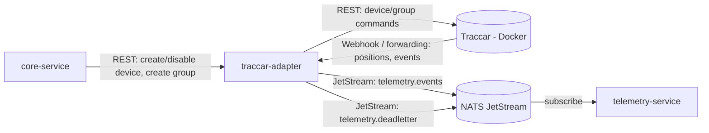
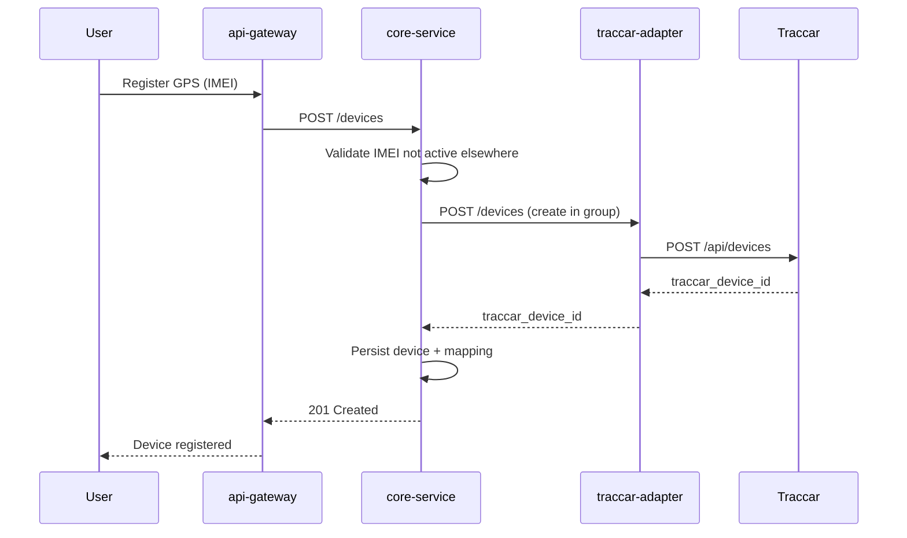
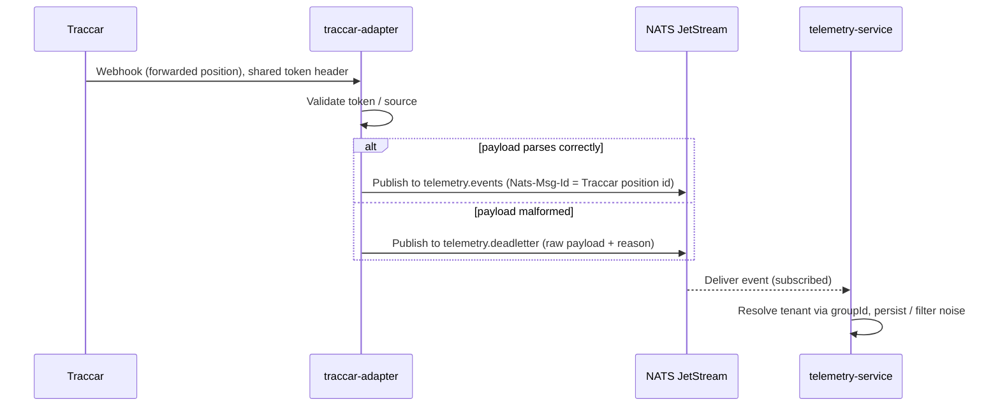

# traccar-adapter — Service Planning Doc

> Fuente de verdad del producto. **No se carga entera en sesiones de implementación**: los specs citan la sección/IDs (FRx, NFRx) que necesitan.

Context for implementation. This service is part of a multitenant vehicle telemetry platform. It is one of five microservices (api-gateway, core-service, traccar-adapter, telemetry-service, realtime-gateway), communicating via REST (sync) and NATS JetStream (async). Internal structure follows hexagonal architecture (ports & adapters) per service. Stack: NestJS, MySQL (other services only), NATS JetStream, Docker, Traccar (containerized), Keycloak (single realm, tenant-scoped groups).

---

## Purpose

traccar-adapter is the **only** part of the system that knows Traccar exists. It isolates every other service from Traccar's API — if Traccar were ever replaced by a different GPS provider, only this service would change.

Its vocabulary is strictly **Device** and **Group** (Traccar's own concepts). It has no notion of "vehicle," "tenant," or any other business entity — those live in core-service.

---

## Phase 1 — Configuration

### Architecture & principles

- **Hexagonal architecture (ports & adapters)**, applied inside this service:
  - **Domain** — entities/rules with zero framework dependencies (e.g. a `Device`, a `Group`, in Traccar's own terms).
  - **Application** — use cases orchestrating the domain (e.g. `CreateGroupUseCase`, `RegisterDeviceUseCase`, `DisableDeviceUseCase`, `IngestPositionUseCase`).
  - **Ports** — interfaces the application layer depends on without implementing (e.g. `TraccarClientPort`, `EventPublisherPort`, `DeadLetterPublisherPort`).
  - **Adapters** — concrete implementations plugged in via DI: an HTTP client implementing `TraccarClientPort` against Traccar's REST API, a JetStream publisher implementing `EventPublisherPort`.
- **Stateless by design.** No own database for business data. No persistence of locations, events, or malformed payloads — that's telemetry-service's job (see Phase 2 and 3).
- **No operation may move a device between groups.** Not restricted by convention — absent from the API surface entirely. A device belongs to one tenant's group for its lifetime (see Phase 2).
- **NestJS modules**, communicating with other services over:
  - **REST (sync)** — for direct commands initiated by core-service (create group, register device, disable/enable device).
  - **NATS JetStream (async)** — for outbound events (normalized positions/events, dead-letter payloads). JetStream chosen over plain NATS pub/sub specifically for built-in message persistence and deduplication (see Phase 3).

### Communication topology

### Security configuration

- **Inbound webhook endpoint** (receives Traccar's forwarding): protected by
  - a **shared token**, configured as a custom header in Traccar's `traccar.xml` forwarding config (`forward.header.*` — confirm exact parameter name per forwarding type: position vs. event forwarding).
  - an **IP allowlist** — in practice enforced for free at the docker-compose network level, since traccar-adapter and the Traccar container share an internal Docker network; the webhook port should not be reachable from outside that network.
- **Outbound calls to Traccar's REST API**: authenticated per Traccar's own API auth mechanism (confirm: session cookie vs. token, depending on Traccar version deployed).
- Traccar version/config to be pinned explicitly once Docker setup is finalized (Phase 4, not covered here).

### Open configuration items (verify empirically in the Docker Traccar instance before implementation)

- [ ] Exact forwarding config parameter names in `traccar.xml` for the shared-token header, for both position forwarding and event forwarding.
- [ ] Confirm disabling a device (`disabled: true` via API) takes effect immediately, no restart required — **confirmed working in current Traccar version**.
- [ ] Confirm a disabled device stops being forwarded entirely (not just stops being *accepted*) — **confirmed: disabled device stops being forwarded**.
- [ ] Confirm Traccar REST auth mechanism in use.

---

## Phase 2 — Business rules for GPS flows

### Responsibilities (in scope)

| ID | Responsibility |
| --- | --- |
| FR1 | Create a Traccar **group** when core-service requests it, at tenant onboarding — not lazily on first device registration (avoids a race condition where two concurrent device registrations could each create a duplicate group). Returns `traccar_group_id`. |
| FR2 | Register a new **device** in Traccar under a given group (given a unique IMEI), on request from core-service. Returns `traccar_device_id`. |
| FR3 | Expose **no operation** capable of moving a device from one group to another. Devices are not transferable between tenants, structurally — not by convention. |
| FR4 | Disable / re-enable a device in Traccar, on request from core-service (triggered when core-service soft-deletes/reactivates a device on its side). |
| FR5 | Receive forwarded position/event data pushed by Traccar via the webhook endpoint, tagged with Traccar's `groupId` and `deviceId` only (no tenant resolution here — see below). |
| FR6 | Normalize raw Traccar payloads into the platform's own event format. |
| FR9 | Publish correctly-parsed events to JetStream stream `telemetry.events`, using Traccar's own position `id` as the `Nats-Msg-Id` header for automatic deduplication (handles Traccar's own forwarding retries without custom dedup logic). |
| FR10 | Publish any payload that fails to parse/process to JetStream stream `telemetry.deadletter`, including the raw payload and failure reason. **Never discard a payload silently.** |

### Explicitly out of scope (do not implement here)

| Would-be responsibility | Actually belongs to | Why |
| --- | --- | --- |
| Storing locations/events in a database | telemetry-service | traccar-adapter stays stateless; separating ingestion from storage means a crash/restart here never threatens the storage pipeline. |
| WebSocket connections to the frontend / real-time push to users | realtime-gateway | traccar-adapter never talks to end users — its only outbound destination is NATS. |
| Resolving `groupId` → `tenant_id` | telemetry-service (via core-service) | traccar-adapter manages Traccar, it does not own tenant data. core-service owns the `tenant_id ↔ traccar_group_id` / `vehicle_id ↔ traccar_device_id` mapping. |
| IMEI uniqueness validation | core-service | Business validation on a business entity (Device record) — not traccar-adapter's concern; it just executes the Traccar-side registration once core-service has already validated. |
| Noise filtering of near-duplicate GPS readings (vehicle stationary, near-identical pings) | telemetry-service | A storage decision ("is this position worth persisting"), not an idempotency concern. |

### Device lifecycle rules

- **IMEI uniqueness** is scoped to **active** devices only (enforced in core-service, not here) — a soft-deleted device's IMEI becomes available again for a new registration, which creates a **new** device record (new ID), never reactivating or transferring the old one.
- **No cross-tenant transfer, ever** — enforced structurally in traccar-adapter (FR3) and in core-service's write path (never creates such a mapping).
- **Soft delete only** — devices are never physically removed from Traccar. On deactivation, core-service triggers FR4 (disable in Traccar) to stop data flow at the source, rather than filtering disabled devices downstream in multiple services.

### Idempotency & resilience

- **Real duplicates** (Traccar's own forwarding retry sending the same message twice): handled by JetStream dedup via `Nats-Msg-Id` = Traccar's position `id` (FR9). No custom logic needed in traccar-adapter.
- **Traccar's forwarding reliability caveat**: Traccar's forward-retry queue is in-memory only, bounded (defaults: 10 retries, 100 queued positions), with no persisted confirmation of delivery. Extended traccar-adapter downtime beyond that window = **permanent data loss** for that period, on Traccar's side, not recoverable after the fact.
  - Open decision: accept this bounded risk, or add a periodic REST reconciliation poll against Traccar's API as a backfill safety net (push-for-speed + poll-for-correctness pattern). **Not yet decided — flag for Phase 2 refinement.**

### Sequence — device registration

### Sequence — position ingestion

---

## Phase 3 — Log management

- **Structured logging via NestJS Logger** for traceability: every REST command to Traccar (create/disable device, create group), every webhook received, every publish to `telemetry.events` or `telemetry.deadletter` — logged with enough context to trace a request end-to-end (correlation/request ID recommended).
- **Logger is for traceability/debugging, not for guaranteed delivery.** It is explicitly *not* the mechanism for "don't lose malformed payloads" — that's JetStream's dead-letter stream (FR10), which persists the payload itself, not just a log line about it.
- **JetStream persistence/retention**: both `telemetry.events` and `telemetry.deadletter` streams must have persistence and a retention policy configured (time- or size-based) so a downed consumer doesn't mean lost messages within that window (NFR6).
- Querying dead-lettered payloads for study: handled downstream by telemetry-service subscribing to `telemetry.deadletter` and persisting to its own DB (a separate table from location history) if that's wanted — **not** a responsibility or a database added to traccar-adapter.

---

## Requirements summary table

| ID | Type | Requirement |
| --- | --- | --- |
| FR1 | Functional | Create Traccar group at tenant onboarding, on request |
| FR2 | Functional | Register device in Traccar under a group, on request |
| FR3 | Functional | No operation exists to move a device between groups |
| FR4 | Functional | Disable/enable device in Traccar, on request |
| FR5 | Functional | Receive forwarded position/event data via webhook |
| FR6 | Functional | Normalize raw Traccar payloads to platform event format |
| FR9 | Functional | Publish parsed events to `telemetry.events` with dedup via `Nats-Msg-Id` |
| FR10 | Functional | Publish unparseable payloads to `telemetry.deadletter`, never discard silently |
| NFR1 | Non-functional | Device status (active/disabled) stays consistent between core-service DB and Traccar; sync-failure retry/alert path defined |
| NFR2 | Non-functional | Traccar's forward-retry queue is in-memory/bounded — define max acceptable traccar-adapter downtime or add reconciliation polling |
| NFR3 | Non-functional | Group/device creation calls are idempotent or guarded against concurrent duplicate creation |
| NFR4 | Non-functional | Every create/disable/enable operation on a device or group is logged (who, when, result) |
| NFR5 | Non-functional | No code path, in any service, can transfer a device between groups |
| NFR6 | Non-functional | Both JetStream streams have persistence + retention configured |

## Open questions (not yet resolved)

1. Reconciliation polling against Traccar's REST API — adopt as backup for forwarding's bounded retry window, or accept the risk? (NFR2)
2. groupId → tenant_id resolution strategy in telemetry-service: synchronous call to core-service per event, or a locally cached mapping kept in sync via events from core-service?
3. Exact Traccar XML config parameter names for the shared-token header (position forwarding vs. event forwarding may differ).
4. Traccar REST API auth mechanism to use for traccar-adapter's outbound calls.
